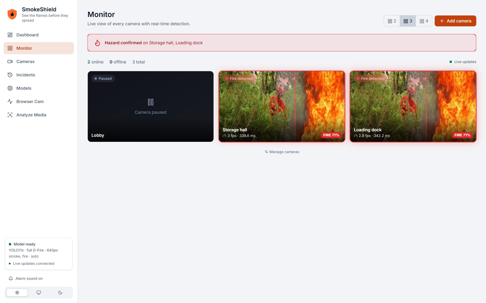
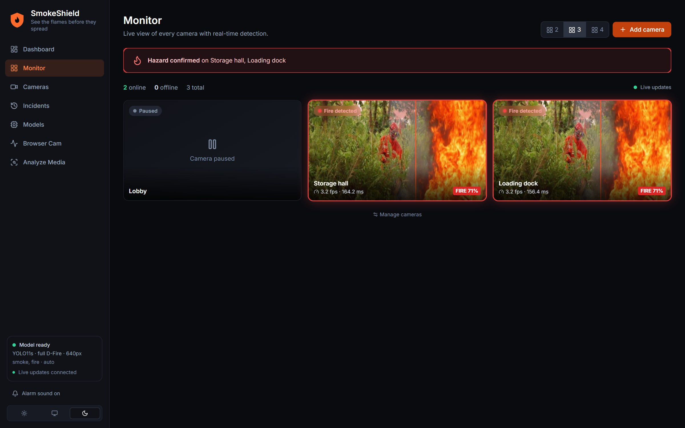
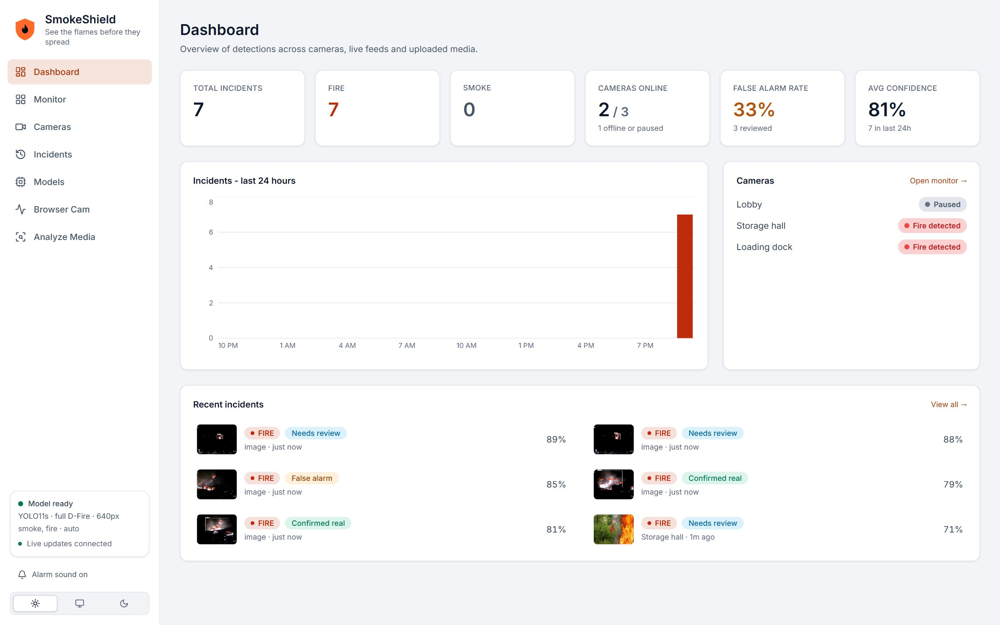
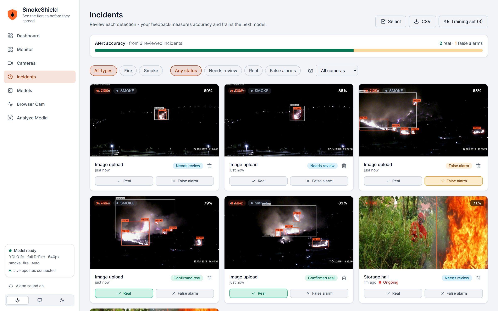
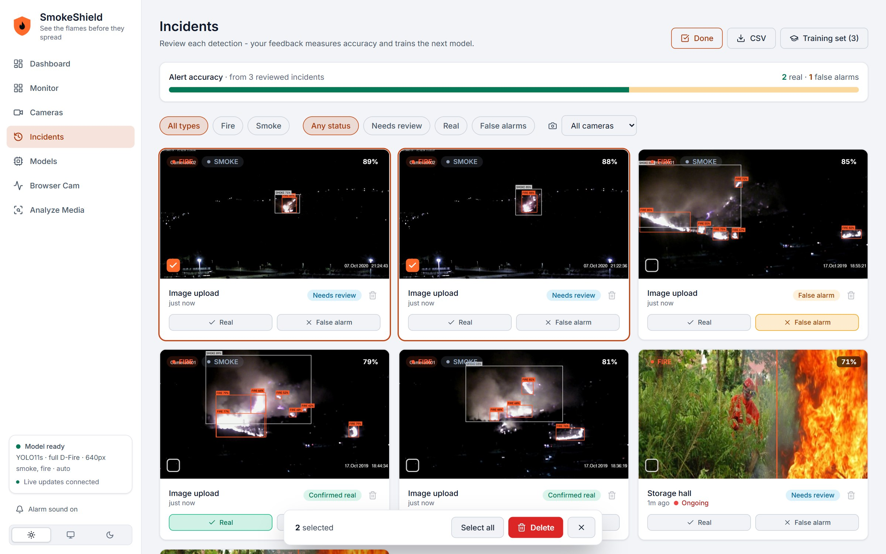
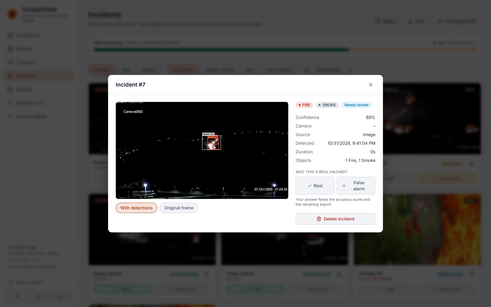
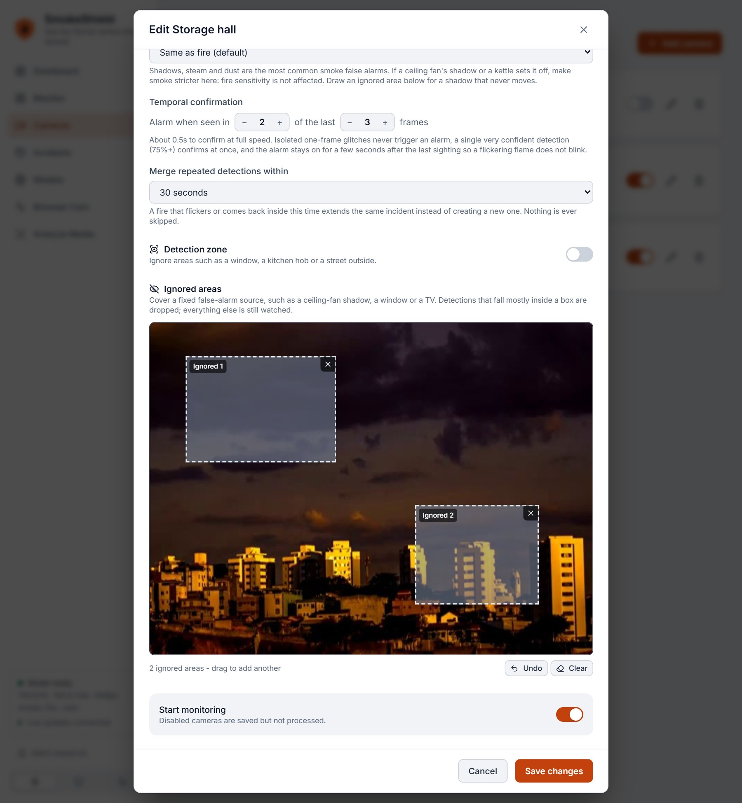
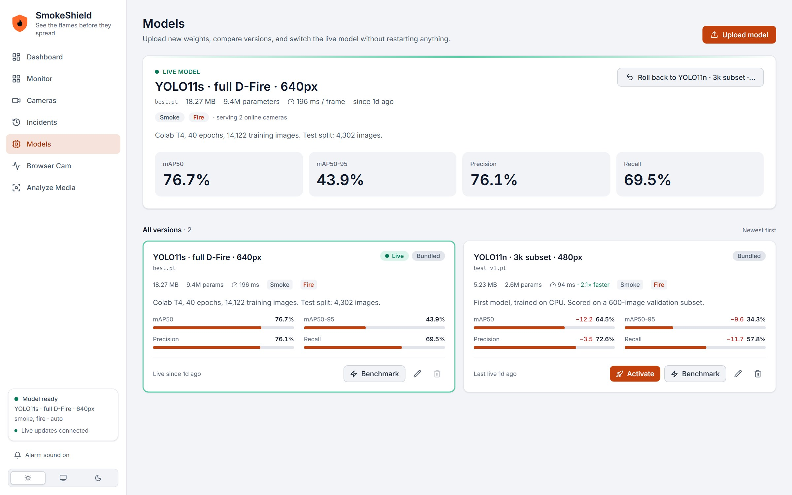

# SmokeShield — Fire & Smoke Detection with YOLO

Real-time fire and smoke detection platform: a **FastAPI + Ultralytics YOLO** backend and a **React + TypeScript + Tailwind** dashboard.



## Screenshots
Every page is available in light and dark themes (a dark Monitor is shown below).

| | |
|---|---|
| <br>**Monitor** - live annotated cameras with status, FPS and latency, and a hazard banner when a fire or smoke is confirmed | <br>**Dashboard** - totals, false-alarm rate, a 24-hour chart, camera health and the latest incidents |
| <br>**Incidents** - one card per event, with the best picture, how long it lasted and one-click *Real* / *False alarm* review | <br>**Select and delete** - pick several incidents and remove them together; a flame and its smoke show as FIRE and SMOKE badges on one card |
| <br>**Incident detail** - detections or the original frame, review, **Ignore this area** for a fixed false-alarm source, and delete | <br>**Camera settings** - smoke sensitivity, detection zone and **ignored areas** drawn on a live preview |
| <br>**Models** - upload weights, compare accuracy and speed, hot-swap the live model, roll back | |

## Features
**Monitoring**
- **Multi-camera grid** – live annotated view of every camera with status (Monitoring / Smoke / Fire / Offline / Paused), FPS and latency, a pulsing alarm state, and a one-click expanded view
- **Camera management** – add, edit, pause and delete cameras; sources are **RTSP/HTTP streams, uploaded video files (looped, processed on the server) or a server webcam**; stream passwords are masked in the API
- **Auto-reconnect** – each camera runs in its own worker with exponential back-off, so one dead camera never affects the others
- **Real-time toasts and alarm sound** from anywhere in the app when a hazard is confirmed

**Fewer false alarms**
- **Stable alarms** – an alarm needs the hazard in *N of the last M frames* (default 3 of 5), so one-frame glitches never trigger; one very confident detection (75%+) confirms at once; and once on, the alarm and its last box stay for a few seconds after the last sighting, so a flickering flame does not blink on and off. Boxes seen but not yet confirmed show as an amber "Possible fire"
- **Per-camera sensitivity** – confidence, confirmation window, detail level, merge window, with *Sensitive / Balanced / Strict / Close-range* presets
- **Smoke sensitivity** – smoke is the class that shadows, steam and dust fool, so it has its own setting: *Same as fire*, *Stricter (60%)*, *Strict (70%)*, *Very strict (80%)* or *Off (fire only)*. Fire sensitivity is never affected, so small flames are still caught
- **Ignored areas** – draw boxes on a live preview over a fixed false-alarm source such as a **ceiling-fan shadow**, a window or a TV; a detection that falls mostly inside a box is dropped, while a real fire next to it still alarms. The live feed shows ignored areas greyed out with a dashed outline
- **One-click "Ignore this area"** – on an incident, turn its own boxes into an ignored area on that camera; the incident is filed as a false alarm, which also makes it a training example
- **Detection zones** – draw a polygon on a live preview; detections outside it are ignored
- **One incident per event** – a flame and the smoke around it are the same event, so they share ONE incident (filed as fire as soon as any fire is seen, even if smoke came first). A continuous or flickering hazard keeps extending that incident, and if it returns within the merge window it extends the same one rather than starting another. The incident keeps its single best picture, replaced in place when a clearer frame arrives, so the list shows one image per event. A failed write is retried on the next frame
- **Incident review** – mark each incident *Real* or *False alarm*; the dashboard shows the false-alarm rate, and reviewed incidents export as a **YOLO training set** (real = boxes, false alarm = negative example) for retraining
- **Delete incidents** – a trash icon on every card, or **Select** several and delete them together (with a confirmation that says how many). If an incident is deleted while its fire is still in view, the next sighting is recorded as a new incident instead of being silently lost

**Model management**
- **Model versions page** – upload new weights, see accuracy and CPU speed side by side, and compare each version against the live one (mAP change in points, "2.6x faster")
- **Hot swap, no restart** – activate a version and every camera uses it on its very next frame; the old model keeps serving until the new one has loaded cleanly, so a bad file can never take detection down
- **One-click rollback** to whichever model was live before
- Uploads are validated before they are accepted: the file must load as YOLO, must contain a fire or smoke class (COCO-style models are rejected), and duplicates are detected by hash

**Also**
- **Analyze Media** – drag-and-drop images or videos with a confidence timeline and peak frame
- **Browser Cam** – quick webcam test from the browser over WebSocket
- **Dashboard** – animated metrics, 24-hour chart (in local time), camera health, recent incidents
- **Light / Dark / System theme** – follows the OS live, remembers your choice, no flash on load, WCAG AA contrast in both themes
- **Works on small screens** – dialogs never grow past the window: the title bar and the action buttons stay in view and only the form scrolls
- Light-weight SQLite database with automatic in-place migration, model health reporting, 106 automated tests

## Architecture
```
                  ┌── CameraWorker (thread per camera) ──┐
RTSP / file / USB ┤   grab → YOLO → filters → N-of-M     ├─► one incident per event (SQLite + snapshots)
                  └──────────────┬───────────────────────┘
                                 │ shared, lock-protected model
Browser (React) ◄─ REST (cameras, incidents, stats, latest frame)
        ◄─────────── WebSocket /ws/events  (camera states + incident alerts, 1 Hz)
        ◄──────────► WebSocket /ws/stream  (browser-webcam test)
```

| Layer    | Tech |
|----------|------|
| Model    | Ultralytics YOLO (YOLO11n by default, any YOLOv8+ weights work) |
| Backend  | Python 3.11, FastAPI, Uvicorn, SQLAlchemy, OpenCV, pydantic-settings |
| Frontend | React 18, Vite, TypeScript, Tailwind CSS, Framer Motion, Recharts, lucide-react |

## Quick start

### 1. Backend
```bash
cd backend
python -m venv .venv
.venv\Scripts\activate          # Windows  (source .venv/bin/activate on Linux/macOS)
pip install -r requirements.txt
cp .env.example .env            # optional
```
Put your trained weights at **`backend/models/best.pt`** (classes must include `fire` and `smoke`), then:
```bash
uvicorn app.main:app --reload --port 8000
```
Interactive API docs: http://localhost:8000/docs

> No weights yet? Train them (below). Without `best.pt` the API runs but reports `model_missing` and the UI shows a banner.

### 2. Frontend
```bash
cd frontend
npm install
npm run dev                      # http://localhost:5173
```
For a single-process deployment run `npm run build`; the backend then serves `frontend/dist` at `/`.

### 3. Train your model
Download a fire/smoke dataset in YOLO format (e.g. D-Fire, or Roboflow Universe "fire smoke detection"), then:
```bash
cd backend
python train.py --data path/to/data.yaml --base yolo11n.pt --epochs 50
```
The best weights are copied to `models/best.pt` and validation mAP is printed — include it in your report.

### 4. Docker (optional)
```bash
docker compose up --build        # http://localhost:8000
```
Mount your weights in `backend/models/best.pt`; the incident DB and snapshots persist in a named volume. (Docker setup is untested on this machine.)

## Model results
**YOLO11s** fine-tuned on the full D-Fire training set (14,122 images), 40 epochs at 640 px on a Google Colab T4 GPU. Evaluated on the **4,302-image held-out test split**, which was never used for training or model selection.

| Class | Precision | Recall | mAP50 | mAP50-95 |
|---|---|---|---|---|
| all | 0.761 | 0.695 | 0.767 | 0.439 |
| smoke | 0.814 | 0.764 | 0.829 | 0.509 |
| fire | 0.708 | 0.627 | 0.706 | 0.369 |

Figures: [training curves](docs/model/results.png) · [confusion matrix](docs/model/confusion_matrix.png) · [precision-recall curve](docs/model/BoxPR_curve.png)

**Improvement over the first model** (YOLO11n, 3,000-image subset, 480 px, trained on CPU; scored on a 600-image validation subset, so the two evaluation sets differ and the test set is the more reliable one):

| | First model | Current model |
|---|---|---|
| Fire recall | 0.482 | **0.627** |
| Fire mAP50 | 0.541 | **0.706** |
| Smoke recall | 0.673 | **0.764** |
| Overall mAP50 | 0.645 | **0.767** |

**Same 90 unseen test images through the running API** (30 fire, 30 smoke-only, 30 with neither; confidence 0.3):

| | First model | Current model |
|---|---|---|
| Fire found | 24 / 30 | **29 / 30** |
| Smoke found | 22 / 30 | **29 / 30** |
| False alarms on empty images | 3 / 30 | **1 / 30** |

**Speed on a CPU-only PC (Intel i5-9500):** median 175 ms per image, 90th percentile 294 ms, through the API. This model is roughly 3x heavier than the first one; if several cameras lag, lower `SMOKESHIELD_WORKER_FPS`.

**Reading the numbers honestly**
- Fire is harder than smoke: flames vary hugely in size, brightness and shape, and small distant fires are easy to miss. Recall of 0.63 means a single frame can still miss a fire, which is why alarms use temporal confirmation across several frames.
- The training curves show validation loss still falling and mAP still rising at epoch 40 (no overfitting), so a longer run would likely add a little more.
- The confusion matrix is computed by Ultralytics at a confidence of 0.001 so that mAP can be integrated over all thresholds. The large "background" counts therefore reflect that very low threshold, not the behaviour at the 0.3 - 0.4 confidence the app actually uses. Smoke/fire mix-ups are tiny (18 and 20 boxes).
- The first model's weights are kept as `backend/models/best_v1.pt` for rollback.

## API
| Method | Path | Purpose |
|---|---|---|
| GET | `/api/health` | model status, classes, device, cameras online |
| GET/POST | `/api/cameras` | list / create a camera |
| GET/PATCH/DELETE | `/api/cameras/{id}` | read / partially update / remove. Besides the basics, a camera has `zone`, `detect_smoke`, `smoke_confidence` (stricter bar for smoke only) and `ignore_areas` (up to 16 `[x1, y1, x2, y2]` boxes, normalised 0..1) |
| GET | `/api/cameras/status` | live state of every camera |
| GET | `/api/cameras/{id}/frame` | latest annotated frame (JPEG, 204 if none yet) |
| GET | `/api/cameras/{id}/snapshot` | clean frame, used by the zone editor |
| POST | `/api/cameras/preview` | grab one frame from a not-yet-saved source |
| POST | `/api/cameras/upload-video` | upload a video file to use as a camera source |
| GET | `/api/incidents` | list; filters `label`, `status`, `camera_id`, `limit`, `offset` |
| PATCH | `/api/incidents/{id}/review` | `{"status": "real" \| "false_alarm" \| "new"}` |
| GET | `/api/incidents/export/training` | reviewed incidents as a YOLO dataset (zip) |
| DELETE | `/api/incidents/{id}` | remove incident + snapshots |
| POST | `/api/incidents/bulk-delete` | `{"ids": [...]}` (1-500) remove several at once; unknown ids are skipped; returns `{"deleted": n}` |
| GET | `/api/stats` | totals, hourly buckets, review metrics, camera counts |
| GET | `/api/models` | registered model versions with accuracy, speed and which one is live |
| POST | `/api/models` | upload weights (multipart `file`, `name`, optional `notes` and metrics as fractions); validated, not activated |
| PATCH | `/api/models/{id}` | edit name, notes and accuracy numbers |
| POST | `/api/models/{id}/activate` | hot-swap the live model |
| POST | `/api/models/rollback` | re-activate the previously live model |
| POST | `/api/models/{id}/benchmark` | re-measure speed and classes on this server |
| DELETE | `/api/models/{id}` | remove a version and its file (not the live one) |
| POST | `/api/detect/image?conf=0.4` | image → detections + annotated image |
| POST | `/api/detect/video?conf=0.4` | video → timeline + peak frame |
| WS | `/ws/events` | camera states and new-incident events |
| WS | `/ws/stream?conf=0.4` | browser webcam: binary JPEG in → JSON detections out |

### Choosing sensitivity
| Preset | Confidence | Confirmation | Use for |
|---|---|---|---|
| Sensitive | 30% | 2 of 3 frames | kitchens, labs - miss nothing |
| Balanced | 40% | 3 of 5 frames | offices, warehouses |
| Strict | 55% | 4 of 6 frames | outdoors, steam / dust / headlights |
| Close-range | 25% | 2 of 4 frames, 960 px | lighter, match, candle (see *Small flames* below) |

At the default 4 inferences per second, "3 of 5" confirms a real fire in about 0.75 s at full speed (a single detection of 75%+ confirms immediately). Change the rate with `SMOKESHIELD_WORKER_FPS`.

### Shadows, steam and other smoke look-alikes
A moving grey patch, such as the shadow of a **ceiling fan** on a wall, looks a lot like smoke to the model, and smoke is its weaker class. Lowering the confidence for small flames (the Close-range preset) loosens the smoke bar too, and a fan shadow never goes away, so asking for more frames in a row does not help. Three tools, from quickest to most thorough:

| Tool | What it does | Use when |
|---|---|---|
| **Ignore this area** (button on an incident) | turns that incident's boxes into an ignored area on its camera and files it as a false alarm | the false alarm always appears in the same place |
| **Ignored areas** (camera settings) | detections mostly inside a drawn box are dropped; anything else is still watched | a fixed source: fan shadow, window, TV, reflective sign |
| **Smoke sensitivity** (camera settings) | holds smoke alone to 60 / 70 / 80% confidence, or switches it off | steam, dust or shadows that move around; fire sensitivity is unchanged |

Keep ignored areas tight: a real fire or smoke inside one is ignored too. The lasting fix is data: every incident you mark **False alarm** is exported as a negative example in the training set, so retraining on a few dozen fan-shadow frames teaches the model to stop seeing them.

### Small flames: lighters, matches, candles
The model was trained on D-Fire, mostly surveillance-style fires. Half of its training flames fill **under 0.5% of the frame**, and a lighter flame is in that range, so it is the hardest case. Measured on held-out images with the live model:

| What was measured | Result |
|---|---|
| Real tiny flames (<0.5% of the frame), found per frame | 45% at confidence 0.40, 65% at 0.25, 82% at 0.10 |
| A 0.5% flame on a 1280x720 webcam, model at 640 / 960 / 1280 px | found 19% / 31% / 49% of frames at 0.40 |
| The same flame through the old Browser Cam (frames shrunk to 640 px wide) | 12% |
| Empty scenes that trigger a fire box at confidence 0.40 / 0.25 / 0.15 | 0% / 0% / 1.7% (60 scenes, a small sample) |
| Inference time per frame at 640 / 960 / 1280 px (Intel i5-9500, CPU) | 198 ms / 394 ms / 704 ms |

What the app does about it: the **Detail level** setting gives the model more pixels (slower), the **Close-range** preset (confidence 0.25, 2 of 4 frames, 960 px) accepts weaker, rarer sightings, server webcams are opened at 1280x720, and the **Live Monitor** page shows weak detections below your threshold so you can see what the model half-sees. The Close-range thresholds come from the numbers above, not from tests on real lighters; tune them with the Live Monitor page.

**The lasting fix is data.** The model has never seen a lighter or match flame. Collect clips of your own scenes, label them, and fine-tune (see the Colab steps used for the first retraining).

## Tests
```bash
cd backend && pytest
```
106 tests cover the alarm tracker (hysteresis, hold-over, instant path), incident episodes (one incident per event, flame plus smoke, smoke-then-fire upgrade, merge, extend, retry), single and bulk delete (including a fire that is still in view when its incident is deleted), zones, ignored areas and the smoke filters, camera CRUD and validation, a video-file camera end to end (upload → worker → confirmed fire → incident), review and export, migration of old databases, and the model registry (upload rules, hot swap, rollback, failed activation keeping the current model, exact class matching, cache headers). They use a fake detector and a temporary data folder, so they need no PyTorch, weights or real data.

## Project layout
```
backend/
  app/
    api/        one router per area: cameras, incidents, stats, detect, events, health
    services/   detector, camera_worker, camera_manager, model_manager, model_registry, confirmation (alarm tracker), episodes, zones (zone, ignored-area and smoke filters), incidents, imaging
    schemas/    request / response models
    db/         SQLAlchemy models, session, in-place migration
    config.py   main.py
  tests/  train.py  prepare_dataset.py
frontend/src/
  pages/        Dashboard, Monitor, Cameras, Incidents, Models, LiveMonitor, Analyze
  components/   Modal, Toast, StatusPill, Switch, Skeleton, ... plus cameras/ (tile, form, zone and ignored-area editors) and models/ (cards, upload form)
  hooks/        useEvents (shared WebSocket), useCameras, useFramePoll, useTheme
  lib/          api client, alarm sound
```

## Theming
Colors are CSS-variable tokens in `frontend/src/index.css` (`:root` = light, `.dark` = dark), mapped into Tailwind in `tailwind.config.js`, so components use ordinary classes (`bg-ink-900`, `text-slate-400`, `text-heading`) and switch themes automatically. To retheme the app, edit the token values. Rules of thumb:
- Use `text-heading` for headings (not `text-white`); keep `text-white` only on solid colored backgrounds such as the red or orange buttons.
- Anything drawn over video or photos gets the `on-media` class, which keeps dark tokens inside it so overlays stay readable in light mode.
- Charts take colors from the same variables (`rgb(var(--ink-700))`); only `<canvas>` drawing uses fixed colors.

## Model registry notes
- Weights already in `backend/models/` are registered automatically on first start (`best.pt` becomes the live model); uploads are stored in `backend/data/models/`.
- The speed shown is the median over a few runs on this server. It reads higher while cameras are busy, so press *Benchmark* on a quiet server for a fair comparison.
- Accuracy numbers are typed in by whoever trained the model (from the validation table); the server cannot compute them without the dataset.
- Class names are matched exactly (`fire`, `flame`, `smoke`...), never as substrings, so a model that detects a "fire hydrant" is not mistaken for a fire detector.

## Security notes
There is no login yet, so run it on a trusted network. **Model uploads deserve extra care:** PyTorch `.pt` files can execute code when loaded, so anyone who can reach the API could run code on the server by uploading a crafted file. Only expose the app to people you trust, or set `SMOKESHIELD_MODEL_UPLOAD_ENABLED=false` (models already in `backend/models/` are still registered and can be switched). Camera URLs may point at private IPs by design (LAN cameras); only `rtsp`, `rtsps`, `rtmp`, `http`, `https` schemes are accepted. Stream passwords are stored in the local SQLite file in plain text and masked in API responses.

## Ideas to extend
Telegram / e-mail / SMS alerts, login with roles (delete and camera settings should be admin-only), incident video clips, a "merge duplicates" action for older incidents, ONNX / OpenVINO export for edge devices.
